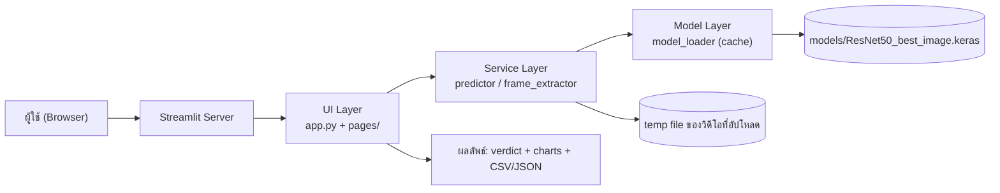
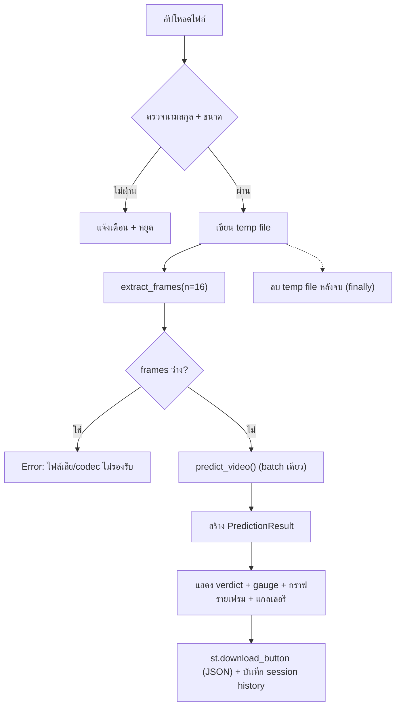

# เอกสารออกแบบระบบ: AI vs Real Video Detector (เว็บแอป Streamlit)

| รายการ | รายละเอียด |
|---|---|
| ชื่อระบบ | AI vs Real Video Detector |
| ประเภท | เว็บแอปพลิเคชัน Streamlit (single-service, stateless) |
| โมเดลที่ใช้ | ResNet50 (transfer learning) — ไฟล์ `ResNet50_best_image.keras` |
| แหล่งที่มาของโมเดล | โน้ตบุ๊ก `AI_Real_Video_ResNet50_vscode.ipynb` (ฝึกบน Colab + GPU) |
| เวอร์ชันเอกสาร | 1.0 — 23 ตุลาคม 2026 |
| สถานะ | กำหนดขอบเขตเพื่อพัฒนา (design ready for implementation) |

---

## 1. บทสรุป

โปรเจกต์นี้มีโมเดลตรวจจับวิดีโอที่สร้างโดย AI (Sora และ generator ในตระกูลเดียวกัน) เทียบกับวิดีโอที่ถ่ายจริง โดยใช้ ResNet50 แบบ transfer learning ที่ฝึกจนได้ **F1 = 0.923 / ROC-AUC = 0.978 บน test set ระดับเฟรม** แต่ผลบนวิดีโอ unseen (นอกชุดข้อมูลฝึก) อยู่ที่ **accuracy 63.7%** จึงมีความจำเป็นต้องสร้างแอปที่ (1) ให้ผู้ใช้อัปโหลดวิดีโอแล้วได้คำตัดสินพร้อมระดับความมั่นใจ (2) โปร่งใสเรื่องความไม่แน่นอนของโมเดล และ (3) คง inference protocol ให้เหมือนโน้ตบุ๊กเป๊ะ เพื่อผลทำนายที่ reproduce ได้

เอกสารนี้ประกอบด้วย 2 ส่วนหลัก: **การวิเคราะห์โมเดลจากโน้ตบุ๊ก** (ส่วนที่ 2) และ **การออกแบบแอป Streamlit** (ส่วนที่ 3 เป็นต้นไป) ครอบคลุมสถาปัตยกรรม โครงสร้างไฟล์ UI สเปกโมดูล inference pipeline การจัดการข้อผิดพลาด เกณฑ์การทดสอบ และแผน deployment

---

## 2. การวิเคราะห์โมเดล (Model Analysis)

### 2.1 โจทย์และข้อมูล

- **โจทย์:** Binary classification — จำแนกวิดีโอ `REAL` (ถ่ายจริง) vs `FAKE` (สร้างโดย AI)
- **ชุดข้อมูลฝึก** (2 ชุดจาก Kaggle ผ่าน `kagglehub`):
  - `khan4568/ai-vs-real-videos-dataset-animals` (โดเมนสัตว์)
  - `khan4568/ai-vs-real-videos-dataset-human-activity` (โดเมนกิจกรรมมนุษย์)
- **ขนาดข้อมูล:** 2,000 วิดีโอ — สมดุลทุกกลุ่ม (animal: REAL 500 / FAKE 500, human: REAL 500 / FAKE 500)
- **การแบ่งข้อมูล:** Stratified split **ที่ระดับวิดีโอ** (ก่อนตัดเฟรม เพื่อกันวิดีโอเดียวกันหลุดข้าม split) อัตรา 70/15/15, seed 42

| Split | จำนวนวิดีโอ | จำนวนเฟรม (12 เฟรม/วิดีโอ) |
|---|---|---|
| train | 1,400 (REAL 700 / FAKE 700) | 16,800 |
| val | 300 (REAL 150 / FAKE 150) | 3,600 |
| test | 300 (REAL 150 / FAKE 150) | 3,600 |

### 2.2 Pipeline การเตรียมข้อมูล

1. สำรวจไฟล์วิดีโอ (`.mp4 .mov .avi .webm .mkv`) แล้วจัดกลุ่ม REAL/FAKE จาก**ชื่อโฟลเดอร์แม่** (`"AI Animals"`, `"Real Human activity"` ฯลฯ — ต้อง `.strip().lower()` เพราะชื่อโฟลเดอร์บางตัวมีช่องว่างแฝง)
2. แบ่ง split ที่ระดับวิดีโอ (sort ก่อน shuffle เพื่อ reproducible)
3. ตัดเฟรมแบบ **uniform sampling**: `idxs = [int(total * f / (n+1)) for f in 1..n]` — เลี่ยงเฟรมต้น/ท้ายคลิป, resize เป็น 224×224, บันทึกเป็น JPG ลง `data/split/{train,val,test}/{FAKE,REAL}/`
4. โหลดด้วย `tf.keras.utils.image_dataset_from_directory` → class เรียงตามตัวอักษรได้ `['FAKE', 'REAL']` → **FAKE=0, REAL=1**

### 2.3 สถาปัตยกรรมโมเดล

```
Input (224, 224, 3)
  └─ ResNet50 (ImageNet pre-trained, include_top=False)   ← backbone
       └─ GlobalAveragePooling2D
            └─ Dropout(0.3)
                 └─ Dense(1, activation="sigmoid")          ← P(REAL)
```

- โมเดลทาย **ความน่าจะเป็นของคลาส index 1 = REAL** ดังนั้น `prob(FAKE) = 1 − sigmoid_output` ⚠️ จุดนี้เป็น source ของ bug "label กลับด้าน" ในอดีต และเป็นสาเหตุที่โน้ตบุ๊กต้องทำ canary test ก่อนใช้งานจริง
- `MODEL_REGISTRY` ออกแบบเป็น registry pattern (ปัจจุบันมีตัวเดียวคือ ResNet50) — แอปควรเก็บแนวคิดนี้ไว้เพื่อรองรับโมเดลเพิ่มในอนาคต

### 2.4 การฝึกโมเดล (2 เฟส)

| ระยะ | ค่าที่ตั้ง | รายละเอียด |
|---|---|---|
| เฟส 1 — Head training | epochs 8, Adam lr=1e-3 | freeze backbone ทั้งหมด ฝึกเฉพาะ head |
| เฟส 2 — Fine-tuning | epochs 6, Adam lr=1e-5 | unfreeze 30% ชั้นบนสุดของ backbone (freeze 70% แรก) |

- Loss: `binary_crossentropy`, metrics: `accuracy`, `AUC`
- Callbacks ทุกเฟส: `EarlyStopping(val_loss, patience=4, restore_best_weights=True)`, `ReduceLROnPlateau(val_loss, factor=0.5, patience=2, min_lr=1e-7)`, `ModelCheckpoint(save_best_only=True, monitor=val_loss)`
- batch size 32, seed 42 (random / numpy / tf)
- บันทึกโมเดลที่ดีที่สุดเป็น `ResNet50_best_image.keras` (format `.keras` ใหม่ของ Keras 3)

### 2.5 ผลการประเมิน

**ระดับเฟรม — Test set (3,600 เฟรม, FAKE เป็น positive class):**

| model | accuracy | precision | recall | f1 | roc_auc |
|---|---|---|---|---|---|
| ResNet50 | 0.9206 | 0.8914 | 0.9578 | 0.9234 | 0.9783 |

Classification report:

| คลาส | precision | recall | f1 | support |
|---|---|---|---|---|
| REAL | 0.95 | 0.88 | 0.92 | 1,800 |
| FAKE | 0.89 | 0.96 | 0.92 | 1,800 |

**ระดับวิดีโอ — Unseen set (113 ไฟล์: REAL 43 / FAKE 70, ใช้ soft-voting + threshold 0.55):**

| ตัวชี้วัด | ค่า |
|---|---|
| Accuracy | **63.7%** (72/113) |
| REAL recall | 74.4% (32/43) |
| FAKE recall | 57.1% (40/70) |
| FAKE precision | 78.4% (40/51 ที่ทำนาย fake) |
| ผลทำนายรวม | fake 51 / real 62 / error 0 |

Confusion matrix (unseen):

```
                 predicted real   predicted fake
  actual real          32               11
  actual fake          30               40
```

### 2.6 Inference protocol ระดับวิดีโอ (สิ่งที่แอปต้องทำซ้ำให้เหมือนเป๊ะ)

1. เปิดวิดีโอด้วย `cv2.VideoCapture` อ่านจำนวนเฟรมทั้งหมด (`CAP_PROP_FRAME_COUNT`)
2. สุ่ม **16 เฟรม** แบบ uniform ด้วยสูตรเดียวกับตอนฝึก: `idxs = [int(total * f / 17) for f in 1..16]`
3. แต่ละเฟรม: `cvtColor(BGR2RGB)` → `resize(224, 224)`
4. รวมเป็น batch float32 → `resnet50.preprocess_input()` → `model.predict()` ครั้งเดียว
5. `frame_probs(fake) = 1 − sigmoid_output` (เพราะ sigmoid = P(REAL), ค่า `CLASS_INDEX_FAKE = 0`)
6. `mean_prob = mean(frame_probs)` → **fake ถ้า `mean_prob ≥ 0.55`** ไม่งั้น real
7. เก็บ `frame_probs` รายเฟรมไว้แสดงผลด้วย (ใช้วิเคราะห์ว่าวิดีโอนั้น "มั่นใจสม่ำเสมอ" หรือ "แกว่งรุนแรง")

### 2.7 ข้อค้นพบสำคัญและความเสี่ยง (สำหรับการออกแบบแอป)

| # | ข้อค้นพบ | ผลต่อการออกแบบ |
|---|---|---|
| 1 | **Generalization gap:** F1 0.923 (in-distribution) → accuracy 63.7% (unseen) โมเดลจับ "ลายนิ้วมือของ generator" ที่เจอตอนฝึกได้ดี แต่ generalization จำกัด | แอปต้องแสดงความมั่นใจเป็นตัวเลขเสมอ + มี disclaimer ชัดเจน ห้ามแสดงผลแบบ "คำตัดสินเด็ดขาด" |
| 2 | **FAKE recall ต่ำใน unseen (57%)** และ mean_prob ของวิดีโอ fake จำนวนมากกระจุกอยู่ช่วง 0.03–0.48 (ใกล้เส้นแบ่ง) | ควรทำ threshold เป็นค่าปรับได้ใน UI + แนะนำการ calibrate กับ validation set จริงใน roadmap |
| 3 | **Label mapping กลับด้านเป็นระเบิดเวลา:** `FAKE=0, REAL=1` ทำให้ sigmoid = P(REAL) ตรงข้ามกับสัญชาตญาณ | แอปต้อง isolate การแปลงนี้ไว้ที่เดียว (`predictor.py`) + มี canary self-test ก่อนใช้งาน |
| 4 | จำนวนเฟรมตอนฝึก (12) กับตอน inference (16) ไม่เท่ากัน (สูตร sampling เดียวกัน ถือว่า acceptable) | เปิดเป็น config ได้ (ค่าเริ่มต้น 16 ตาม canary ที่ผ่านมาแล้ว) |
| 5 | โค้ดโน้ตบุ๊กผูกกับ Colab หนักมาก (`drive.mount`, path `/content/drive/...`, `files.download`) | แอปต้อง decouple: โมเดลอยู่ใน `models/` ของโปรเจกต์, ใช้ `st.download_button` แทน |
| 6 | ชุด test มาจาก dataset เดียวกับชุดฝึก (generator families ซ้ำกัน) ทำให้เลข 92% "สวยเกินจริง" เทียบกับการใช้งานจริง | แสดงเลขทั้งสองชุด (test และ unseen) ในหน้าข้อมูลโมเดล เพื่อความโปร่งใส |
| 7 | วิดีโอบางไฟล์อ่านเฟรมได้ไม่ครบ (`n_frames_used < N_FRAMES`) | ต้องรายงานจำนวนเฟรมที่ใช้จริงในผลลัพธ์ และมี edge-case handling |

---

## 3. เป้าหมายและขอบเขตของแอป

### 3.1 เป้าหมาย

1. ผู้ใช้อัปโหลดไฟล์วิดีโอ แล้วได้ผล `REAL / FAKE` + ความมั่นใจ ภายในไม่กี่วินาที (CPU ก็ได้)
2. แสดงผลแบบโปร่งใส: ความน่าจะเป็นรายเฟรม, เฟรมที่ใช้, ค่า threshold — ไม่ใช่แค่คำตอบเดียว
3. รองรับ batch (หลายไฟล์) พร้อม export CSV เลียนแบบ workflow ท้ายโน้ตบุ๊ก
4. ผลทำนาย reproduce ได้ — pipeline เดียวกับโน้ตบุ๊กเป๊ะ (ตรวจด้วย canary test)

### 3.2 ขอบเขต (In scope)

- อัปโหลดไฟล์เดี่ยว / หลายไฟล์ (`.mp4 .mov .avi .webm .mkv`)
- การทำนายด้วย ResNet50 (`.keras`) บนเครื่องที่รันแอป
- ปรับ `N_FRAMES` และ `VOTE_THRESHOLD` ได้จาก UI (มีค่าเริ่มต้นตาม canary: 16 / 0.55)
- ประวัติการทำนายใน session + ดาวน์โหลดผลเป็น CSV/JSON
- หน้าแสดงข้อมูลโมเดลและข้อจำกัด

### 3.3 นอกขอบเขต (Out of scope — เวอร์ชันแรก)

- การฝึก/retrain โมเดลในแอป
- การวิเคราะห์เชิง forensic (metadata, GAN-fingerprint ฯลฯ)
- ระบบผู้ใช้/การล็อกอิน, การเก็บข้อมูลอัปโหลดถาวร (แอป stateless ไม่เก็บไฟล์หลังจบ session)
- REST API แยกต่างหาก (มีไว้ใน roadmap)

---

## 4. สถาปัตยกรรมระบบ



หลักการ:

- **Single process** — Streamlit รัน inference ใน process เดียว (เหมาะกับการใช้งานทีมเล็ก/demo)
- **แยกชั้นชัดเจน:** UI ไม่รู้จัก TensorFlow โดยตรง; ตรรกะการทำนายทั้งหมดอยู่ใน service layer ที่ทดสอบแยกได้ (เรียกจาก Python ล้วนได้โดยไม่ต้องมี Streamlit)
- **Stateless** — ไม่มี DB; ประวัติเก็บใน `st.session_state` เท่านั้น

---

## 5. โครงสร้างโปรเจกต์

```
ai-real-video-app/
├── app.py                      # entrypoint: st.navigation + layout + sidebar ที่ใช้ร่วม
├── requirements.txt
├── .streamlit/
│   └── config.toml             # maxUploadSize, theme
├── models/
│   └── ResNet50_best_image.keras
├── assets/
│   └── canary/                 # วิดีโออ้างอิง 2 ไฟล์ (real 1 + fake 1) สำหรับ self-test
├── src/
│   ├── __init__.py
│   ├── config.py               # CONFIG เดียวกับโน้ตบุ๊ก + ค่า default ของแอป
│   ├── model_loader.py         # load_model() พร้อม @st.cache_resource
│   ├── frame_extractor.py      # extract_frames() — uniform sampling
│   ├── predictor.py            # predict_video() → PredictionResult (จุดเดียวที่แปลง label)
│   ├── visuals.py              # กราฟ gauge / bar รายเฟรม / แกลเลอรีเฟรม
│   └── pages/
│       ├── detect.py           # หน้าหลัก: อัปโหลด + ผลลัพธ์
│       ├── batch.py            # หลายไฟล์ + export CSV
│       ├── history.py          # ประวัติใน session
│       └── model_info.py       # metrics, สถาปัตยกรรม, ข้อจำกัด, canary self-test
├── tests/
│   ├── test_frame_extractor.py # สูตร sampling ตรงกับโน้ตบุ๊ก
│   ├── test_predictor.py       # label mapping (FAKE=0/REAL=1)
│   └── test_canary.py          # วิดีโออ้างอิงทำนายถูก + mean_prob ตรงค่า baseline
└── README.md
```

### 5.1 ตาราง "จากโน้ตบุ๊ก → แอป" (สิ่งที่เก็บ / สิ่งที่เปลี่ยน)

| ในโน้ตบุ๊ก | ในแอป | เหตุผล |
|---|---|---|
| `CONFIG` dict กลาง | `src/config.py` | ค่าเดียวกันทั้งระบบ แก้ที่เดียว |
| `drive.mount('/content/drive')` + path Drive | โฟลเดอร์ `models/` ในโปรเจกต์ | decouple จาก Colab |
| `MODEL_REGISTRY` | เก็บไว้ใน `config.py` (dict name → path/preprocess) | พร้อมรองรับหลายโมเดลในอนาคต |
| `extract_frames()` (cell 46) | `src/frame_extractor.py` (เหมือนกันเป๊ะ) | reproduce ผล canary |
| `predict_video()` (cell 46) | `src/predictor.py` | เหมือนกันเป๊ะ + คืน dataclass |
| `print()` ทีละบรรทัด | `st.progress` / `st.status` / `st.dataframe` | UX บนเว็บ |
| matplotlib + seaborn | Plotly / `st.metric` / `st.pyplot` ตามชนิดกราฟ | กราฟเว็บที่ interactive ได้ |
| `files.download('predictions.csv')` | `st.download_button` | กลไกดาวน์โหลดของ Streamlit |
| ผล metrics ใน output cell | หน้า `model_info.py` (ฝังตัวเลขจริง + confusion matrix) | ความโปร่งใสต่อผู้ใช้ |
| canary test ด้วยมือ | `tests/test_canary.py` + ปุ่ม self-test ใน UI | กัน regression เรื่อง label กลับด้าน |

### 5.2 `requirements.txt` (เวอร์ชันแรก)

```text
streamlit>=1.36
tensorflow>=2.16        # หรือ tensorflow-cpu>=2.16 ถ้าเครื่องไม่มี GPU
opencv-python-headless
numpy
pandas
plotly
```

> โน้ตบุ๊กใช้ TensorFlow 2.20 และฟอร์แมต `.keras` (Keras 3) — แอปควรใช้ TF ≥ 2.16 เพื่อความเข้ากันได้ของฟอร์แมต

---

## 6. การออกแบบหน้าจอ (UI/UX)

### 6.1 โครงหน้าหลัก (Detect)

```
┌────────────────────────────────────────────────────────────────┐
│  AI vs Real Video Detector                     [Detect|Batch|… │
├──────────────┬─────────────────────────────────────────────────┤
│ SIDEBAR      │  🎯 อัปโหลดวิดีโอเพื่อตรวจสอบ                     │
│              │  ┌───────────────────────────────────────────┐  │
│ โมเดล:       │  │        Drag & drop วิดีโอไฟล์ตรงนี้          │  │
│ ResNet50 ✓   │  │   (mp4, mov, avi, webm, mkv ≤ 500 MB)      │  │
│              │  └───────────────────────────────────────────┘  │
│ การตั้งค่า:   │                                                 │
│ เฟรม: [16]   │  ▶ ตัวอย่างวิดีโอ (st.video)                     │
│ เกณฑ์: [0.55]│  ───────────────────────────────────────────  │
│              │  ⏳ กำลังสุ่ม 16 เฟรมและวิเคราะห์… (progress)     │
│ ℹ️ โมเดลนี้   │                                                 │
│ มีความไม่     │  ┌─────────────┐   mean prob(FAKE) = 0.87     │
│ แน่นอน ดู    │  │   🔴 FAKE    │   ความมั่นใจ: สูง              │
│ หน้าข้อมูล    │   │   87%       │   เฟรมที่ใช้: 16/16            │
│              │  └─────────────┘                                 │
│              │  [gauge ความน่าจะเป็น FAKE]                      │
│              │  [bar chart ความน่าจะเป็น FAKE รายเฟรม]          │
│              │  [แกลเลอรีเฟรมที่สุ่ม + ค่า prob ใต้ภาพ]           │
│              │  ⚠️ ข้อจำกัด: โมเดลนี้… (disclaimer สั้น)          │
│              │  ⬇️ ดาวน์โหลดรายงาน JSON   [เพิ่มลงประวัติ]        │
└──────────────┴─────────────────────────────────────────────────┘
```

### 6.2 องค์ประกอบ UI ที่กำหนด

| องค์ประกอบ | พฤติกรรม |
|---|---|
| `st.file_uploader` (accept หลายไฟล์, `type=VIDEO_EXTS`) | จำกัดขนาดผ่าน `server.maxUploadSize=500` |
| ปุ่ม "เริ่มวิเคราะห์" (`st.button`) | ไม่ predict ทันทีที่อัปโหลด — ให้ผู้ใช้กดเอง กัน re-run เปล่า (Streamlit rerun ทั้ง script) |
| `st.status` / `st.progress` | ขั้นตอน: บันทึก temp → ตัดเฟรม → ทำนาย (รายงาน n/N) → สรุป |
| Verdict card | `st.success`/`st.error` + `st.metric` — สีตามผล; แสดง "confidence band": ช่วง 0.45–0.65 แสดงเป็น "ไม่แน่นอน (borderline)" สีเหลือง |
| Gauge / bar chart รายเฟรม | Plotly; เส้นแสดง threshold ปัจจุบันบนกราฟด้วย |
| แกลเลอรีเฟรม | `st.columns` + `st.image`, ใต้ภาพแสดง prob ของเฟรมนั้น |
| Sidebar — sliders | `N_FRAMES` (8–24, default 16), `VOTE_THRESHOLD` (0.30–0.70, step 0.01, default 0.55) พร้อมคำเตือนว่าการขยับค่ามีผลต่อคำตอบ |
| `st.session_state["history"]` | list ของ dict ผลลัพธ์ + ปุ่มล้างประวัติ |

### 6.3 หน้าอื่น ๆ

- **Batch:** อัปโหลดหลายไฟล์ → ตารางผลแบบเดียวกับ output ท้ายโน้ตบุ๊ก (`filename, n_frames_used, mean_prob_fake, predicted_label` + เฟรมเวลาที่ใช้) → `st.download_button` CSV
- **History:** ตารางผลใน session ปัจจุบัน
- **Model Info:** สถาปัตยกรรม, ตาราง metrics (test และ unseen ทั้งคู่), confusion matrix, ข้อจำกัด, และ**ปุ่มรัน canary self-test** (ทำนายวิดีโออ้างอิงใน `assets/canary/` แล้วเทียบค่า baseline — ต้องผ่านทั้ง 2 ไฟล์)

---

## 7. สเปกโมดูล (Module Specification)

### 7.1 `src/config.py`

```python
from pathlib import Path

CONFIG = {
    # --- โมเดล ---
    "MODEL_PATH": Path("models/ResNet50_best_image.keras"),
    "MODEL_NAME": "ResNet50",
    "IMG_SIZE": (224, 224),
    "CLASS_INDEX_FAKE": 0,          # FAKE=0, REAL=1 (จาก image_dataset_from_directory)
    # --- inference (ค่า default ตาม canary ที่ผ่านแล้วในโน้ตบุ๊ก) ---
    "N_FRAMES": 16,
    "VOTE_THRESHOLD": 0.55,
    "VIDEO_EXTS": (".mp4", ".mov", ".avi", ".webm", ".mkv"),
    "MAX_UPLOAD_MB": 500,
    "BORDERLINE_BAND": (0.45, 0.65),  # ช่วงที่ถือว่าผลไม่ชัด
}

MODEL_REGISTRY = {
    "ResNet50": {
        "path": CONFIG["MODEL_PATH"],
        "preprocess": "tensorflow.keras.applications.resnet50.preprocess_input",
    },
}
```

### 7.2 `src/model_loader.py`

```python
import streamlit as st
import tensorflow as tf

@st.cache_resource(show_spinner="กำลังโหลดโมเดล ResNet50…")
def load_model(model_path: str) -> tf.keras.Model:
    model = tf.keras.models.load_model(model_path)
    return model
```

- `@st.cache_resource` โหลดครั้งเดียวต่อ process — สำคัญมากเพราะการโหลด `.keras` ใหญ่ (~100 MB) และ TF init ช้า
- มี `get_model_info()` คืน `model.input_shape`, จำนวน params ไปแสดงในหน้า Model Info

### 7.3 `src/frame_extractor.py`

```python
def extract_frames(video_path: str, n_frames: int = 16, img_size=(224, 224)) -> list:
    """Uniform sampling ตามสูตร idx = int(total * f / (n+1)), f = 1..n
    คืน list ของ RGB ndarray ขนาด img_size (เรียงตามลำดับเวลา)"""
```

- ต้องใช้สูตร index **เหมือนโน้ตบุ๊กเป๊ะ** (มี unit test ยืนยัน)
- กรณี `total <= 0` หรืออ่านเฟรมไม่ได้เลย → คืน `[]` ให้ caller จัดการ
- รับ path (จาก temp file ที่แอปเขียนจาก bytes ที่อัปโหลด) — ไม่ถอดรหัสอะไรในหน่วยความจำทั้งวิดีโอ กัน OOM

### 7.4 `src/predictor.py` (จุดเดียวที่แปลง label — ห้ามกระจาย)

```python
from dataclasses import dataclass, field

@dataclass
class PredictionResult:
    label: str                      # "fake" | "real"
    mean_prob_fake: float
    frame_probs: list[float] = field(default_factory=list)
    n_frames_used: int = 0
    threshold: float = 0.55
    borderline: bool = False        # mean_prob อยู่ในช่วง BORDERLINE_BAND

def predict_video(model, frames, threshold=0.55, class_index_fake=0) -> PredictionResult:
    batch = np.array(frames, dtype="float32")
    batch = preprocess_input(batch)          # resnet50.preprocess_input
    preds = model.predict(batch, verbose=0)  # sigmoid = P(index 1) = P(REAL)
    if preds.shape[-1] == 1:
        raw = preds[:, 0]
        frame_probs = raw if class_index_fake == 1 else (1.0 - raw)
    else:
        frame_probs = preds[:, class_index_fake]
    mean_prob = float(np.mean(frame_probs))
    ...
```

- ตรรกะลอกจาก cell 46 ของโน้ตบุ๊กทั้งหมด — รวมข้อแก้ที่ `preds.shape[-1] == 1` กรณีโมเดลคืน 1 หน่วย vs 2 หน่วย
- โมดูลนี้**ไม่ import streamlit** เพื่อทดสอบด้วย pytest ได้ตรง ๆ

### 7.5 `src/visuals.py`

| ฟังก์ชัน | งาน |
|---|---|
| `verdict_card(result)` | เรนเดอร์ผล + สี + confidence band |
| `plot_gauge(mean_prob, threshold)` | gauge ความน่าจะเป็น FAKE (Plotly) |
| `plot_frame_probs(frame_probs, threshold)` | bar chart รายเฟรม + เส้น threshold |
| `frame_gallery(frames, frame_probs)` | แสดงเฟรมตัวอย่าง 8–16 ภาพพร้อมค่า prob |

---

## 8. Inference Pipeline ของแอป (แบบ end-to-end)



หมายเหตุ:

- การทำนายทั้งวิดีโอ = **`model.predict` ครั้งเดียว** ด้วย batch 16 เฟรม (เร็วกว่า loop ทีละเฟรมมาก)
- temp file ต้อง `finally: os.remove(...)` เสมอ — แอป stateless ไม่ทิ้งไฟล์ผู้ใช้

---

## 9. ประสิทธิภาพและหน่วยความจำ

| ประเด็น | แนวทาง |
|---|---|
| โหลดโมเดลช้า (~5–15 s) | `@st.cache_resource` + `st.spinner`; โชว์เวลาโหลดครั้งแรกอย่างตรงไปตรงมา |
| Inference ต่อวิดีโอ | 16 เฟรม × ResNet50 บน CPU ปกติ ≈ 2–6 วินาที — ใช้ `st.status` ให้ผู้ใช้รู้ว่ากำลังประมวลผล |
| วิดีโอยาว/ใหญ่ | ต้นทุนหลักคือ **decode + seek** ไม่ใช่โมเดล — `cap.set(CAP_PROP_POS_FRAMES, idx)` แบบโน้ตบุ๊กใช้ได้กับไฟล์ส่วนใหญ่; จำกัดขนาดอัปโหลด 500 MB |
| หน่วยความจำ | เก็บแค่ 16 เฟรม 224×224×3 float32 (~11 MB) ต่อการทำนาย; แกลเลอรีแสดงจาก frame uint8 เดิม ไม่ duplicate |
| Batch หลายไฟล์ | ทำนายเรียงทีละไฟล์ + update `st.progress` (อย่า predict ทุกไฟล์แล้วค่อยแสดง — ผู้ใช้จะคิดว่าค้าง) |
| `gc.collect()` หลัง batch จบ | เลียนแบบโน้ตบุ๊กที่เรียกหลังจบแต่ละโมเดล |

---

## 10. การจัดการข้อผิดพลาดและ Edge Cases

| สถานการณ์ | การจัดการ | ข้อความตัวอย่าง |
|---|---|---|
| อัปโหลดไม่ใช่วิดีโอ/นามสกุลนอก list | บล็อกที่ `file_uploader` + ตรวจซ้ำอีกชั้น | "รองรับเฉพาะ mp4, mov, avi, webm, mkv" |
| ไฟล์ใหญ่เกิน | `server.maxUploadSize` + ข้อความ | "ไฟล์เกิน 500 MB — ลองตัดคลิปให้สั้นลง" |
| อ่านเฟรมไม่ได้ (ไฟล์เสีย / codec) | `extract_frames` คืน `[]` → `st.error` | "อ่านวิดีโอไม่สำเร็จ (ไฟล์อาจเสียหายหรือ codec ไม่รองรับ) ลองแปลงเป็น .mp4 (H.264) ก่อน" |
| อ่านได้ไม่ครบ n เฟรม | ทำนายต่อด้วยเฟรมที่มี + แสดง `n_frames_used` + เตือนถ้า < 8 | "อ่านได้เพียง 5/16 เฟรม — ผลอาจไม่น่าเชื่อถือ" |
| ไม่พบไฟล์โมเดล | ตรวจตอน startup → หน้า setup อธิบายว่าต้องวาง `models/ResNet50_best_image.keras` จาก Drive ของโน้ตบุ๊ก | "ยังไม่พบไฟล์โมเดล ดูวิธีตั้งค่าใน README" |
| mean_prob ใกล้ threshold (borderline) | verdict เป็นสีเหลือง + คำว่า "ไม่แน่นอน" | "ผลใกล้เส้นแบ่ง (0.53) — ลองปรับเกณฑ์หรือเพิ่มจำนวนเฟรม" |
| TensorFlow/dep ผิดเวอร์ชัน | ตรวจตอน import + แสดงเวอร์ชันที่คาดหวัง | แสดง requirement ที่ต้องการ |

---

## 11. การทดสอบและเกณฑ์การยอมรับ

### 11.1 Canary self-test (สำคัญที่สุด — กัน label กลับด้าน)

1. วางวิดีโออ้างอิง 2 ไฟล์ใน `assets/canary/` (real 1, fake 1) พร้อมค่า `mean_prob` baseline ที่บันทึกจากโน้ตบุ๊กไว้ใน `assets/canary/baseline.json`
2. ทดสอบ: ทำนายทั้ง 2 ไฟล์ → label ต้องถูกทั้งคู่ **และ** `mean_prob` ต่างจาก baseline ไม่เกิน ±0.02
3. รันอัตโนมัติด้วย pytest (`tests/test_canary.py`) และมีปุ่มรันในหน้า Model Info

### 11.2 เกณฑ์การยอมรับ (Acceptance criteria)

- [ ] วิดีโอเดียวกัน + ค่าตั้งเดียวกัน ให้ผลเหมือนโน้ตบุ๊ก (±0.02 ใน mean_prob)
- [ ] Canary ผ่าน 2/2 หลังแต่ละ deploy
- [ ] เวลาต่อการทำนาย ≤ 10 วินาทีสำหรับคลิปสั้นกว่า 1 นาทีบน CPU ทั่วไป
- [ ] Edge cases ในตารางส่วนที่ 10 ทุกข้อมีข้อความที่เข้าใจได้ (ไม่มี stack trace ดิบ ๆ)
- [ ] ผล borderline (0.45–0.65) แสดงสถานะ "ไม่แน่นอน" เสมอ
- [ ] Batch ≥ 10 ไฟล์ รันจบโดยมี progress และ export CSV ได้สมบูรณ์
- [ ] ไม่มีไฟล์ผู้ใช้ตกค้างใน temp หลังการทำนาย

---

## 12. การติดตั้งและ Deployment

### 12.1 รันบนเครื่อง (แนะนำเป็นจุดเริ่ม)

```bash
python -m venv .venv
.venv\Scripts\activate            # Windows
pip install -r requirements.txt
# วาง ResNet50_best_image.keras ลง models/ (ดาวน์โหลดจาก Google Drive ของโปรเจกต์)
streamlit run app.py
```

`.streamlit/config.toml`:

```toml
[server]
maxUploadSize = 500

[theme]
base = "light"
```

### 12.2 Streamlit Community Cloud

- Push โค้ดขึ้น GitHub → deploy จากหน้า Streamlit Cloud, entrypoint `app.py`
- ไฟล์โมเดล ~100 MB: ใส่ใน repo ได้ (แต่ควรใช้ **Git LFS** หรือดาวน์โหลดตอน startup จาก Google Drive/Hugging Face แทน เพื่อไม่ให้ repo บวม)
- ใช้ `tensorflow-cpu` ใน requirements เมื่อรันบน instance ฟรี (ไม่มี GPU)

### 12.3 Docker (ทางเลือกสำหรับทีม/เซิร์ฟเวอร์)

```dockerfile
FROM python:3.11-slim
WORKDIR /app
COPY requirements.txt .
RUN pip install --no-cache-dir -r requirements.txt
COPY . .
EXPOSE 8501
CMD ["streamlit", "run", "app.py", "--server.address=0.0.0.0"]
```

---

## 13. ข้อจำกัดและคำเตือนการใช้งาน (ต้องแสดงในแอป)

1. **ความแม่นยำจริงไม่ใช่ 92%** — ตัวเลข 92.06% มาจาก test set ที่อยู่ใน distribution เดียวกับชุดฝึก; บนวิดีโอ unseen ความแม่นยำระดับวิดีโอคือ **63.7%** ผู้ใช้ต้องเห็นตัวเลขนี้ในหน้าข้อมูลโมเดล
2. โมเดลเป็น **frame-level classifier + soft-voting** — ไม่ได้เรียนรู้ artifact เชิงเวลา (temporal) ของวิดีโอ
3 ชุดข้อมูลฝึกครอบคลุมแค่ 2 โดเมน (สัตว์ / กิจกรรมมนุษย์) และ generator ตระกูลเฉพาะ — วิดีโอโดเมนอื่นหรือ generator รุ่นใหม่อาจทำนายผิดพลาดสูง
4. ผลใกล้เส้นแบ่ง (0.45–0.65) ต้องตีความว่า "ไม่แน่นอน" เท่านั้น
5. **ห้ามใช้เป็นหลักฐานเด็ดขาด** ในการตัดสินเรื่องใด ๆ — ใช้เป็นเครื่องมือช่วยคัดกรองเบื้องต้นเท่านั้น

---

## 14. Roadmap

| ลำดับ | รายการ | เหตุผล |
|---|---|---|
| 1 | **Calibrate `VOTE_THRESHOLD` บน validation set ระดับวิดีโอ** | ตอนนี้ 0.55 เป็นค่ามือ; unseen data ชี้ว่า fake หลายไฟล์กระจุกใกล้เส้นแบ่ง — tuning น่าจะยก FAKE recall ได้ทันที |
| 2 | ทดลองเพิ่ม `N_FRAMES` (24–32) + เทียบความเสถียรของ mean_prob | ลด variance ของการทำนายระดับวิดีโอ |
| 3 | Grad-CAM overlay บนเฟรมที่โมเดลมั่นใจสูงสุด/ต่ำสุด | ช่วยอธิบายว่าโมเดล "มองตรงไหน" เพิ่มความน่าเชื่อถือ |
| 4 | เพิ่มโมเดลเข้า `MODEL_REGISTRY` (EfficientNet/MobileNetV2 ตามที่โน้ตบุ๊กเตรียนโครงไว้แล้ว) + เลือกได้ใน sidebar | registry pattern พร้อมอยู่แล้ว |
| 5 | Temporal model (เช่น ConvLSTM / TimeDistributed + attention) | จับ artifact ข้ามเฟรมที่ frame-level model มองไม่เห็น |
| 6 | รายงานแยกตามโดเมน (ชื่อไฟล์เฟรมมี prefix `animal__`/`human__` อยู่แล้ว) | รู้ว่าโมเดลอ่อนโดเมนไหน |
| 7 | แยก inference เป็น REST API (FastAPI) + Streamlit เป็น frontend | รองรับผู้ใช้พร้อมกันหลายคน |

---

## ภาคผนวก A: CONFIG จากโน้ตบุ๊ก (อ้างอิงฉบับเต็ม)

| คีย์ | ค่า | หมายเหตุ |
|---|---|---|
| `IMG_SIZE` | 224 | ต้องตรงกับ input ของโมเดล |
| `N_FRAMES_PER_VIDEO` (ฝึก) | 12 | ใช้ตอนสร้าง dataset เฟรม |
| `N_FRAMES` (inference) | 16 | ค่าที่ใช้ใน canary/unseen ที่ผ่านมา — แอปใช้ค่านี้เป็น default |
| `CLASS_NAMES` | `['FAKE', 'REAL']` | FAKE=0, REAL=1 |
| `TRAIN/VAL/TEST_RATIO` | 0.70 / 0.15 / 0.15 | แบ่งที่ระดับวิดีโอ |
| `BATCH_SIZE` | 32 | ใช้ตอนฝึกเท่านั้น |
| `EPOCHS_HEAD` / `EPOCHS_FINETUNE` | 8 / 6 | EarlyStopping อาจหยุดก่อน |
| `LEARNING_RATE` / `FINETUNE_LR` | 1e-3 / 1e-5 | Adam |
| `VOTE_THRESHOLD` | 0.55 | เกณฑ์ soft-voting ระดับวิดีโอ |
| `CLASS_INDEX_FAKE` | 0 | จุดวิกฤต — ทำ canary test ทุกครั้งที่แตะโค้ดส่วนนี้ |

## ภาคผนวก B: เส้นทางไฟล์โมเดลตอนนี้

- **โมเดลปัจจุบันในระบบ:**
  - `models/ResNet50_4dataset.keras` (โมเดลหลักที่ฝึกบน 4 Dataset)
  - `models/ResNet50_best_image.keras` (โมเดลสำรองจาก Google Colab)
- **ระบบจัดการโมเดลแบบไดนามิก:**
  - สามารถอัปโหลดไฟล์โมเดล `.keras` หรือ `.h5` เพิ่มเติมได้ผ่าน UI โดยตรง (Sidebar, หน้าตรวจจับวิดีโอเดี่ยว, หรือหน้าข้อมูลโมเดล)
  - ระบบจะทำการ Validate โครงสร้างโมเดลด้วย TensorFlow อัตโนมัติก่อนเปิดให้ใช้งาน
  - รองรับการสลับโมเดลที่ใช้งานได้ทันที และเลือกลบโมเดลที่ไม่ต้องการได้จากหน้าเว็บ

